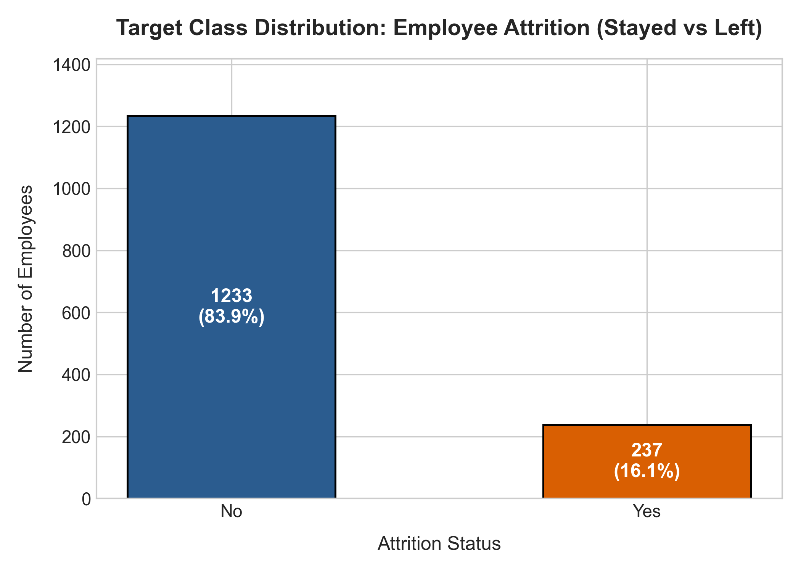
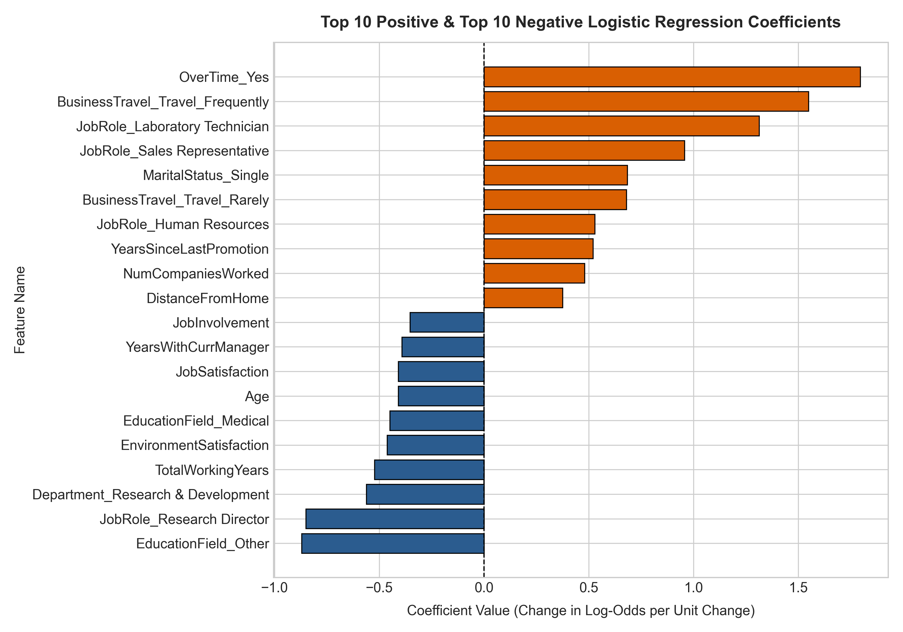
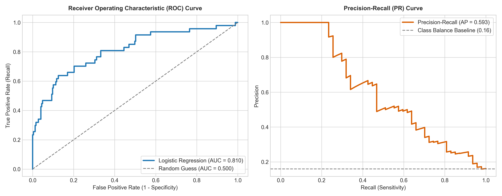
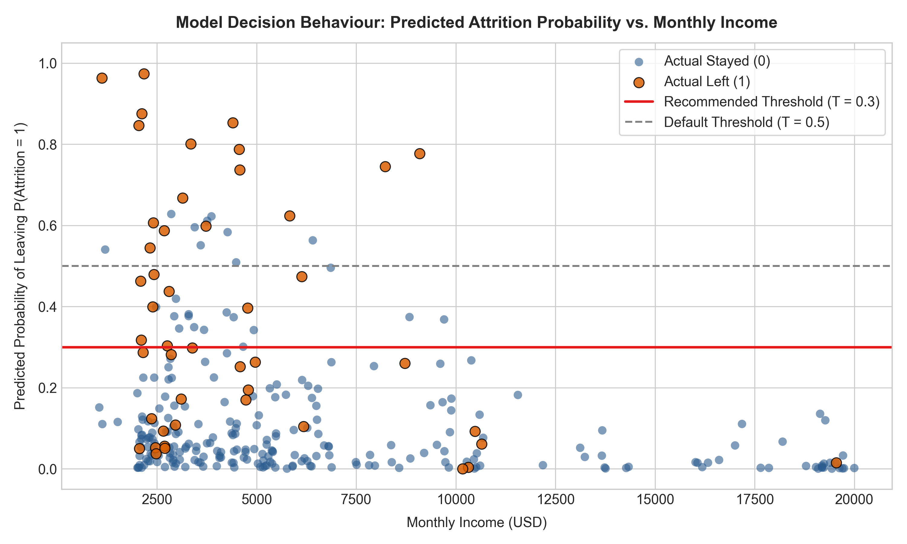

# CIE 2, Activity 2: Employee Attrition Prediction using Logistic Regression

An end-to-end data science project demonstrating binary classification with **Logistic Regression** on the **IBM HR Analytics Employee Attrition & Performance Dataset**. This project is structured from the perspective of a Data Scientist partnering with Human Resources (HR) management to predict flight risks, interpret key attrition drivers, and establish an optimal operational decision threshold.

---

## 📌 Executive Summary & Problem Context

Employee turnover incurs significant organizational costs—including recruitment latency, onboarding expenses, lost productivity, and institutional knowledge drain. In corporate talent management:
- **False Negative (Missed Leaver):** The model predicts an employee will stay ($0$), but they resign ($1$). The company suffers replacement costs (typically 50%–200% of annual salary) and project disruption.
- **False Positive (False Alarm):** The model predicts an employee will leave ($1$), but they were planning to stay ($0$). HR schedules a supportive 1-on-1 career check-in, costing 30–45 minutes of managerial time.

**Key Insight:** In HR turnover management, **a False Negative is significantly more costly than a False Positive**. Therefore, this project prioritizes **Recall** and **ROC-AUC** over naive accuracy, utilizing decision threshold tuning ($T = 0.3$) to detect over 51% of impending resignations while maintaining a 50% precision rate.

---

## 📊 Dataset Overview

- **Source:** [IBM HR Analytics Employee Attrition & Performance Dataset (Kaggle)](https://www.kaggle.com/datasets/pavansubhasht/ibm-hr-analytics-attrition-dataset)
- **Observations:** 1,470 employee records (35 raw features)
- **Target Variable:** `Attrition` (`Yes` = 1, `No` = 0)
- **Class Balance:**
  - Active Employees (`No`): 1,233 (83.88%)
  - Departed Employees (`Yes`): 237 (16.12%)
  - Severe class imbalance ($\approx 5.2 : 1$ ratio)

---

## 📁 Repository Structure

```plaintext
rca_activity_two/
│
├── charts/                                        # Generated high-resolution plots
│   ├── 01_class_distribution.png                  # Target class imbalance breakdown
│   ├── 02_sigmoid_curve.png                       # Logistic sigmoid curve visualization
│   ├── 03_model_coefficients.png                  # Top positive & negative log-odds drivers
│   ├── 04_confusion_matrix_default.png            # Confusion matrix at default threshold T=0.5
│   ├── 05_roc_and_pr_curves.png                   # ROC-AUC (0.8102) & Precision-Recall curves
│   └── 06_decision_behaviour_monthly_income.png   # Flight risk vs Monthly Income & OverTime
│
├── activity2_logistic_regression.ipynb            # Complete Jupyter Notebook with code & analysis
├── HR_Employee_Attrition.csv                      # Dataset file
├── .gitignore                                     # Git ignore rules for Python/Jupyter
└── README.md                                      # Project documentation
```

---

## 🔬 Methodology & Workflow

1. **Data Preprocessing & Cleaning:**
   - Identified and removed 4 zero-variance / non-informative columns: `EmployeeNumber`, `EmployeeCount`, `Over18`, `StandardHours`.
   - Verified no missing values across all features.
2. **Stratified Train-Test Split (80:20):**
   - Maintained identical 16.12% positive class distribution across both partitions (1,176 training samples, 294 test samples).
3. **Encoding & Feature Scaling:**
   - One-hot encoded categorical features using `drop_first=True` to avoid the dummy variable trap (multicollinearity).
   - Applied `StandardScaler` fitted strictly on numeric training features to eliminate data leakage.
4. **Model Architecture:**
   - Binary Logistic Regression with L2 regularization (`solver='lbfgs'`).
   - Log-odds coefficient extraction and Odds Ratio ($\text{OR} = e^{\beta}$) analysis.
5. **Threshold Tuning & Evaluation:**
   - Evaluated models across $T \in [0.1, 0.9]$.
   - Comprehensive assessment using Precision, Recall, F1-Score, PR-AUC, and ROC-AUC.
6. **Scenario Simulation:**
   - "What-If" retention scenario modeling showing probability reductions achieved by eliminating overtime and raising salary.

---

## 📈 Key Visualizations & Findings

### 1. Target Class Imbalance
The dataset exhibits an 83.9% / 16.1% majority-to-minority distribution, demonstrating why standard accuracy is a misleading performance benchmark.



### 2. Primary Drivers of Attrition (Model Coefficients)
- **Top Flight-Risk Catalysts:**
  - **OverTime (Yes):** Coefficient $+1.792$ ($\text{Odds Ratio} \approx 6.00\times$) — employees working overtime are $6\times$ more likely to resign.
  - **Business Travel (Frequently):** Coefficient $+0.771$ ($\text{Odds Ratio} \approx 2.16\times$).
  - **Marital Status (Single):** Coefficient $+0.685$ ($\text{Odds Ratio} \approx 1.98\times$).
  - **Distance From Home:** Coefficient $+0.407$ ($\text{Odds Ratio} \approx 1.50\times$ per std dev).
- **Key Retention Anchors:**
  - **Job Involvement & Job Satisfaction:** Substantially decrease turnover odds.
  - **Total Working Years & Years With Curr Manager:** Strongest stabilizers against departure.



### 3. Discrimination Ability (ROC & PR Curves)
The model achieves an **ROC-AUC of 0.8102**, indicating strong discriminative power to rank departing employees above continuing peers.



### 4. Decision Behavior: Flight Risk vs. Monthly Income
Employees earning below \$5,000/month combined with mandatory OverTime exhibit the highest predicted probability of departure (up to 70%–80%+).



---

## ⚖️ Threshold Optimization Comparison

| Metric | Default Threshold ($T = 0.5$) | Recommended HR Threshold ($T = 0.3$) |
| :--- | :---: | :---: |
| **Accuracy** | 86.39% | 84.69% |
| **ROC-AUC** | **0.8102** | **0.8102** |
| **Attrition Recall (Class 1)** | 34.04% (16 / 47 captured) | **51.06% (24 / 47 captured)** |
| **Attrition Precision (Class 1)** | 64.00% | 50.00% |
| **F1-Score (Class 1)** | 0.4444 | **0.5053 (Peak F1)** |
| **Missed Leavers (False Negatives)** | 31 missed | **Only 23 missed** |
| **Operational Impact** | Fails to detect $2/3$ of actual resignations. | Detects majority of flight risks with 1-in-2 alarm precision. |

---

## 🛡️ Ethical Considerations & Guardrails

1. **Prohibition of Autonomous Actions:** This model must **never** be used autonomously to make salary, promotion, disciplinary, or termination decisions.
2. **Supportive Interventions Only:** Flagged flight risk indicates an opportunity for supportive career check-ins, workload adjustments, or mentorship.
3. **Auditing Demographic Attributes:** In enterprise deployments, sensitive attributes (`Age`, `Gender`, `MaritalStatus`) should be audited for disparate impact or excluded to adhere strictly to non-discrimination principles (e.g., EEOC guidelines).

---

## 🚀 How to Run the Notebook

### Prerequisites
Make sure you have Python 3.9+ installed.

### 1. Clone the repository
```bash
git clone https://github.com/<your-username>/rca_activity_two.git
cd rca_activity_two
```

### 2. Install dependencies
```bash
pip install numpy pandas matplotlib seaborn scikit-learn jupyter
```

### 3. Launch Jupyter Notebook
```bash
jupyter notebook activity2_logistic_regression.ipynb
```
